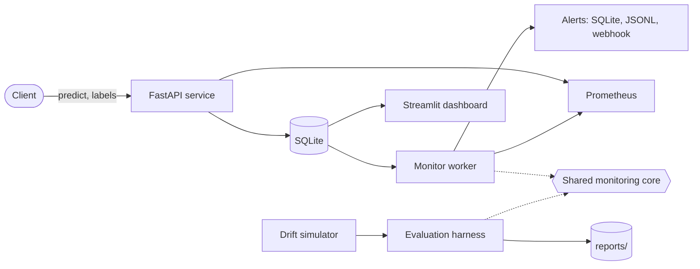

# ml-drift-monitoring

[](https://github.com/hosnahatami04/ml-drift-monitoring/actions/workflows/ci.yml)

Drift detection and observability for production ML, with an evaluation harness that measures how fast and how reliably drift is caught.

A model that scores well today can degrade silently months later, when the data it sees no longer looks like the data it learned from. This repository is a monitoring system for that problem: a prediction service with delayed labels, statistical drift detectors written from scratch (KS, PSI, chi-square, Page-Hinkley), alerting with Prometheus metrics and a dashboard, and a harness that injects known drift and scores the monitor that runs in production. On 30 held-out evaluation streams per scenario at medium severity, sudden covariate drift was caught in every stream within the first drifted window, concept drift in every stream after a median of 6 windows (the labels themselves arrive 3 windows late), and 6.7% of drift-free control streams raised a false alarm. Every number, including the targets that were missed, is in [reports/results.md](reports/results.md). This is a personal project on public data, with no affiliation to any employer.

## Architecture



The monitor worker and the evaluation harness import the same monitoring core, so the evaluation measures the exact code path that runs in production. Data flow and module layout are described in [docs/architecture.md](docs/architecture.md).

## Installation instructions for users

The stack needs a trained model on the host, which is mounted into the containers. Install [uv](https://docs.astral.sh/uv/) and Docker with Compose, then:

```bash
make setup          # Python 3.11 environment from uv.lock
make data train     # download UCI Adult (checksum-verified) and train the model
docker compose up -d --build
```

This starts four services, each with a healthcheck: the API on http://localhost:8000 (interactive docs at `/docs`), the monitor worker with its metrics on port 9100, the dashboard on http://localhost:8501, and Prometheus on http://localhost:9090.

Replay a simulated stream with sudden drift into the running API and list the alerts it raised:

```bash
uv run driftmon replay --scenario sudden_covariate --severity high --url http://localhost:8000
```

A full stream is 60,000 requests and takes several minutes. Set `DRIFTMON_STREAM__N_WINDOWS=25` for a shorter run that still drifts from window 20. Alerts appear in the dashboard and as `driftmon_alerts_total` in Prometheus. Other scenarios: `control`, `gradual_covariate`, `concept`, `seasonal`; severities: `low`, `medium`, `high`.

Without Docker, the same flow runs in one process, with monitoring inline in the API:

```bash
uv run driftmon serve                    # API on http://127.0.0.1:8000
uv run driftmon replay --scenario sudden_covariate --severity high   # in-process
make dashboard                           # http://127.0.0.1:8501
```

## Installation instructions for developers

```bash
uv sync --extra dev --extra dashboard    # same as make setup
uv run pre-commit install
```

`pip install -e ".[dev,dashboard]"` also works if you do not use uv.

| Target | What it does |
| --- | --- |
| `make lint` / `make format` | ruff check and format |
| `make typecheck` | mypy in strict mode on `src/` |
| `make test` / `make cov` | test suite; `cov` fails below 85% coverage |
| `make data` / `make train` | dataset download and model training |
| `make calibrate` | grid-search thresholds on calibration seeds 0-19 and freeze them in `configs/thresholds.yaml` |
| `make evaluate` | full evaluation on seeds 100-129 with ablations; writes `reports/results.json`, `results.md` and `figures/` |
| `make evaluate-smoke` / `make kpi-gate` | small evaluation used by CI, and its regression check against `tests/fixtures/kpi_smoke.json` |
| `make reproduce` | runs the full evaluation twice and checks the two `results.json` files are byte-identical |
| `make dashboard` | Streamlit dashboard |
| `make audit` | pip-audit over the locked dependencies (needs network) |

Tests that need the real dataset are marked `data` and run after `make data train`. Seeds live in `configs/default.yaml` and `PYTHONHASHSEED=0` is set by the Makefile, CI and the Docker image.

```text
src/driftmon/
  data/            download, schema validation, split
  model/           training, artifact, reference statistics
  detectors/       KS, PSI, chi-square, Page-Hinkley, multiple testing
  simulation/      drift scenarios, stream generator, ground truth
  monitoring/      shared Monitor, alert manager, runner
  service/         FastAPI app, SQLite store, HTTP client
  evaluation/      harness, calibration, KPIs, report, CI gate
  observability/   Prometheus metrics, OpenTelemetry tracing
  dashboard/       Streamlit app and its data layer
configs/           settings, frozen thresholds, scenarios
reports/           evaluation results, figures, baseline and severity reports
docs/decisions/    architecture decision records
```

Non-obvious decisions are recorded as ADRs in [docs/decisions/](docs/decisions/), from the choice of uv and a src layout (0002) to threshold calibration on held-out seeds (0008) and the separate monitor worker (0009).

## Contributor expectations

- Work on a branch named `phase-N/short-name` or `topic/short-name` and open a pull request; nothing is pushed to `main` directly. Pull requests are merged with a merge commit, so the commit history stays readable.
- Commit messages follow Conventional Commits (`feat`, `fix`, `test`, `refactor`, `docs`, `chore`, `ci`, `perf`, `build`) in the imperative mood. Each commit keeps the tests green on its own.
- New behaviour comes with tests, and `make lint typecheck cov` must pass. A failing test is fixed, not skipped.
- A decision that someone could reasonably question gets a short ADR: context, decision, alternatives, consequences.
- Every number in a report, the README or a pull request comes from a script in this repository. Thresholds are never tuned on evaluation seeds; a KPI that misses its target is reported as missed.

## Known issues

- **The per-window false alarm rate misses its target**: 0.28% of control windows raised an alert, against a target of at most 0.2%. Both alarming control streams were Page-Hinkley alarms. Page-Hinkley is not reset after it fires, so one false alarm repeats after every cooldown. Changing that needs recalibration and was deliberately not done after seeing the evaluation results (ADR 0008).
- **The drift is simulated, not natural.** It is injected by resampling real rows of one dataset (UCI Adult), so the joint distribution is realistic, but real production drift is messier and rarely arrives as a clean step.
- **Input detectors cannot see pure concept drift.** When only P(y|x) changes, the inputs look the same; on concept streams the input alert rate was identical to control. Concept drift is caught only by Page-Hinkley on the error rate.
- **Concept detection is bounded by label delay.** Labels arrive 3 windows late, so no performance alert can come sooner. At low severity only 46.7% of concept streams were detected within the 20-window horizon.
- **KS is conservative on discrete and zero-heavy features** such as `capital-gain` and `capital-loss`. PSI is run on the same features to cover that gap (ADR 0005).
- **Thresholds are specific to 1000-row windows.** With the same frozen thresholds, 100% of control streams raised a false alarm at 250-row windows and 80% at 500-row windows. Another window size needs recalibration.
- **SQLite on a single node.** WAL mode handles the API and the worker writing concurrently, but only one monitor worker may run against a store, and it is the single point of failure for alerting.
- **Reproducibility holds per machine.** Two runs on the same machine give a byte-identical `results.json`, but XGBoost trained on a different CPU architecture produced a slightly different model with the same library versions, so `results.json` records the model file's hash.
- **The container image is 2.45 GB.** About 470 MB of that is NVIDIA NCCL, which XGBoost pulls in on Linux and which a CPU-only service never uses.
