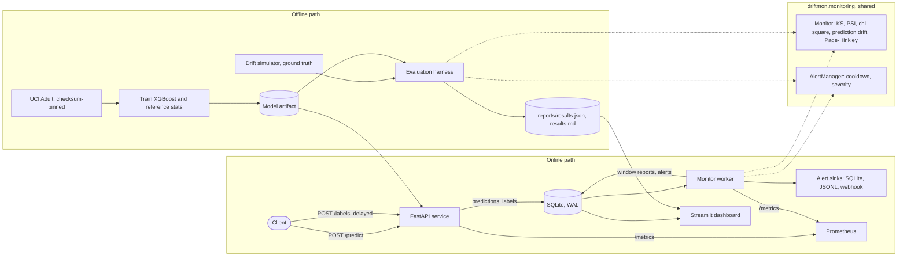

# Architecture

The system has two paths that share one monitoring core. The online path
serves predictions, stores them, and watches them for drift. The offline path
simulates drift with known ground truth and measures how well the same core
catches it. Because the evaluation harness imports the code the service runs,
the numbers in `reports/results.md` describe production behaviour, not a
re-implementation of it.

## Data flow

1. **Data and model.** `driftmon download-data` fetches UCI Adult, checks the
   pinned SHA256, cleans it and splits it into train, validation, reference and
   stream pool (50/10/10/30, stratified). `driftmon train` fits the XGBoost
   model with a logistic regression baseline and stores the model together with
   the reference statistics the detectors compare against (ADR 0003).
2. **Serving.** `POST /predict` validates the features, returns a probability,
   and appends the prediction to SQLite. Windows close by count: every 1000
   predictions form one window (ADR 0007). Labels arrive later through
   `POST /labels`.
3. **Monitoring.** The monitor worker polls the store. For each complete
   window it runs the input detectors (KS and PSI on numeric features, PSI and
   chi-square on categorical features, KS on predicted probabilities), applies
   the Bonferroni correction and the effect-size gate (ADR 0004), and hands the
   report to the alert manager. Once a window's labels have all arrived, its
   error rate goes to Page-Hinkley, which raises performance alerts. On restart
   the worker rebuilds that state from the store (ADR 0009). In a single local
   process the API can run the same steps inline instead.
4. **Alerting and telemetry.** Alerts carry a type (`feature_drift`,
   `prediction_drift`, `performance_drift`), a severity, and a per-type
   cooldown. They go to SQLite and a JSONL file, and optionally to a webhook.
   Both processes expose Prometheus metrics; traces use OpenTelemetry with
   console export by default and OTLP when `OTEL_EXPORTER_OTLP_ENDPOINT` is set.
5. **Evaluation.** The simulator draws streams from the held-out pool. Drift is
   injected by importance resampling of real rows, so the joint distribution
   stays realistic (ADR 0006). Thresholds are calibrated on seeds 0-19 only and
   frozen; KPIs are computed on seeds 100-129 with bootstrap intervals
   (ADR 0008). Two runs produce a byte-identical `results.json`.

## Where things live

| Path | Contents |
| --- | --- |
| `src/driftmon/data` | download, schema validation, split |
| `src/driftmon/model` | training, artifact, reference statistics |
| `src/driftmon/detectors` | hand-written statistical tests and the window decision |
| `src/driftmon/simulation` | scenarios, stream generator, ground truth |
| `src/driftmon/monitoring` | the shared Monitor, alert manager, runner |
| `src/driftmon/service` | FastAPI app, SQLite store, HTTP client |
| `src/driftmon/evaluation` | harness, calibration, KPIs, report, CI gate |
| `src/driftmon/observability` | Prometheus metrics, OpenTelemetry tracing |
| `src/driftmon/dashboard` | Streamlit app and its data layer |
| `configs/` | settings, frozen thresholds, scenario definitions |
| `docs/decisions/` | architecture decision records |
