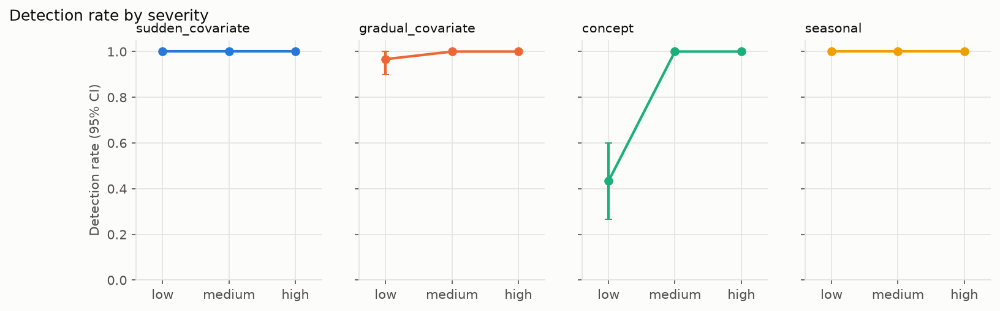
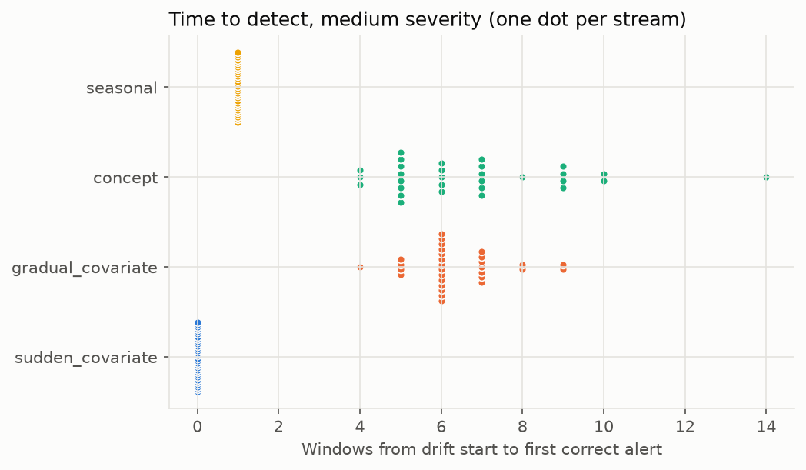
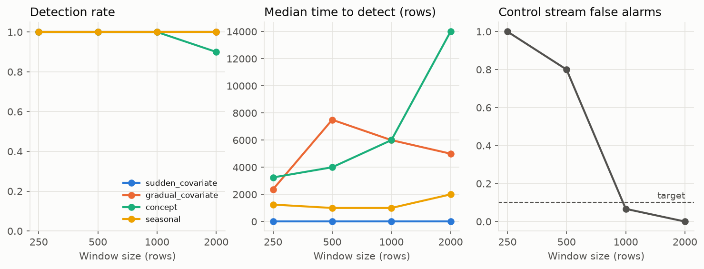
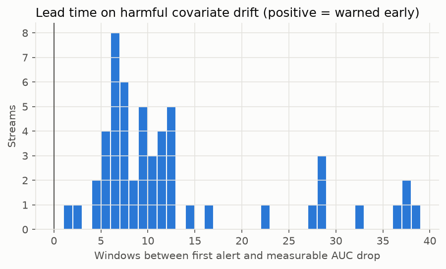

# Evaluation results

Written by `driftmon evaluate` from `results.json` in the same directory; every number below comes from that file.

- Evaluation seeds 100-129 (30 streams per cell), severities: low, medium, high
- Stream: 60 windows of 1000 rows, drift from window 20, label delay 3, detection horizon 20
- Thresholds frozen by calibration on seeds 0-19: alpha 0.001 (bonferroni), k=1, KS D ≥ 0.04, PSI ≥ 0.1, Cramer's V ≥ 0.1, Page-Hinkley delta 0.005 / lambda 0.05
- Model artifact `model-133f4ff37184` (model.pkl sha256 `e95949f30b43`), reference AUC 0.9272; config sha256 `50487b6f3088`
- 95% intervals: percentile bootstrap over streams, 1000 resamples, seed 2026

## Detection KPIs

| KPI | Scope | Value [95% CI] | Target | Status |
| --- | --- | --- | --- | --- |
| Detection rate, sudden covariate | medium severity, evaluation seeds | 100.0% [100.0%, 100.0%] | ≥ 95.0% | met |
| Detection rate, gradual covariate | medium severity, evaluation seeds | 100.0% [100.0%, 100.0%] | ≥ 90.0% | met |
| Detection rate, concept (performance_drift only) | medium severity, evaluation seeds | 100.0% [100.0%, 100.0%] | ≥ 80.0% | met |
| Median time to detect, sudden covariate | medium severity, evaluation seeds | 0.0 [0.0, 0.0] windows | ≤ 1 | met |
| Median time to detect, gradual covariate | medium severity, evaluation seeds | 6.0 [6.0, 7.0] windows | ≤ 6 | met |
| Median time to detect, concept | medium severity, evaluation seeds | 6.0 [5.0, 7.0] windows | ≤ 7 | met |
| Stream false alarm rate (control) | control streams, evaluation seeds | 6.7% [0.0%, 16.7%] | ≤ 10.0% | met |
| Per-window false alarm rate (control) | control streams, evaluation seeds | 0.11% [0.00%, 0.28%] | ≤ 0.2% | met |
| Alert precision, drifted streams | medium severity, evaluation seeds, all drift scenarios pooled | 99.5% [99.0%, 99.9%] | ≥ 90.0% | met |
| Median lead time, harmful covariate drift | covariate scenarios, all severities, streams with degradation | 9.0 [7.0, 11.0] windows | ≥ 1 | met |
| Harmful-drift share | medium severity, evaluation seeds, all drift scenarios pooled | 17.5% [11.7%, 25.0%] | report | - |
| Input-detector alert rate on concept minus control (zero by construction) | medium severity, evaluation seeds, paired by seed | 0.0% [0.0%, 0.0%] | report | - |
| Largest deviation from scipy (KS, chi-square) | random inputs | 0.0e+00 | ≤ 1e-06 | met |

Time to detect counts windows from the drift start to the first correct alert
(0 = caught in the first drifted window). A performance alert is raised when the
window's labels arrive, so concept detection cannot be faster than the label delay.

## By scenario and severity

| Scenario | Severity | Detection rate | Median TTD | Alert precision | Harmful share | Median lead time |
| --- | --- | --- | --- | --- | --- | --- |
| concept | low | 43.3% [26.7%, 60.0%] | 13.0 [8.5, 16.0] | 92.9% [77.8%, 100.0%] | 0.0% [0.0%, 0.0%] | no harmful streams |
| concept | medium | 100.0% [100.0%, 100.0%] | 6.0 [5.0, 7.0] | 96.8% [90.9%, 100.0%] | 66.7% [50.0%, 80.1%] | 6.5 [1.5, 11.0] |
| concept | high | 100.0% [100.0%, 100.0%] | 4.5 [4.0, 5.0] | 96.8% [90.9%, 100.0%] | 100.0% [100.0%, 100.0%] | -3.0 [-3.0, -3.0] |
| gradual_covariate | low | 96.7% [90.0%, 100.0%] | 14.0 [12.0, 15.0] | 98.4% [94.9%, 100.0%] | 0.0% [0.0%, 0.0%] | no harmful streams |
| gradual_covariate | medium | 100.0% [100.0%, 100.0%] | 6.0 [6.0, 7.0] | 99.6% [98.7%, 100.0%] | 0.0% [0.0%, 0.0%] | no harmful streams |
| gradual_covariate | high | 100.0% [100.0%, 100.0%] | 2.0 [2.0, 2.0] | 99.7% [99.0%, 100.0%] | 100.0% [100.0%, 100.0%] | 7.0 [6.0, 9.0] |
| seasonal | low | 100.0% [100.0%, 100.0%] | 2.0 [2.0, 2.0] | 99.3% [97.8%, 100.0%] | 0.0% [0.0%, 0.0%] | no harmful streams |
| seasonal | medium | 100.0% [100.0%, 100.0%] | 1.0 [1.0, 1.0] | 99.7% [99.0%, 100.0%] | 0.0% [0.0%, 0.0%] | no harmful streams |
| seasonal | high | 100.0% [100.0%, 100.0%] | 1.0 [1.0, 1.0] | 99.7% [99.2%, 100.0%] | 10.0% [0.0%, 23.3%] | 37.0 [27.0, 37.0] |
| sudden_covariate | low | 100.0% [100.0%, 100.0%] | 0.0 [0.0, 0.0] | 99.5% [98.6%, 100.0%] | 0.0% [0.0%, 0.0%] | no harmful streams |
| sudden_covariate | medium | 100.0% [100.0%, 100.0%] | 0.0 [0.0, 0.0] | 99.7% [99.1%, 100.0%] | 3.3% [0.0%, 10.0%] | 12.0 [12.0, 12.0] |
| sudden_covariate | high | 100.0% [100.0%, 100.0%] | 0.0 [0.0, 0.0] | 99.7% [99.1%, 100.0%] | 63.3% [46.7%, 80.0%] | 12.0 [11.0, 28.0] |

## Control streams

- 30 streams with no injected drift
- Stream false alarm rate: 6.7% [0.0%, 16.7%]
- Per-window false alarm rate: 0.11% [0.00%, 0.28%]
- Streams with at least one alarm, by type: feature_drift 0, performance_drift 2, prediction_drift 0
- Alerts by type: feature_drift 0, performance_drift 2, prediction_drift 0
- Streams whose rolling AUC dropped below the degradation line anyway: 0.0% [0.0%, 0.0%] (noise floor for harmful share)

## Detector correctness

Largest absolute deviation from scipy over random inputs:

- chi2_p_value: 0.00e+00
- chi2_statistic: 0.00e+00
- ks_p_value: 0.00e+00
- ks_statistic: 0.00e+00

## Ablations

All arms reuse the frozen detector thresholds; none is re-tuned, so an arm's false
alarm rate moves along with its sensitivity. Method, gate and correction arms change
only the input-side decision and are scored on feature_drift alerts alone. The
window-size arms keep the traffic volume fixed: drift start, horizon, label delay,
alert cooldown and scenario timing are scaled in rows (the table below lists what
each arm actually ran, including where a value had to be rounded), and they are
scored on all alerts, so their time to detect is also given in rows.

Detection counts any relevant alert inside the horizon, so an arm with a high
control false alarm rate also "detects" by chance; read detection next to the
false alarm columns.

### method (feature_drift)

| Arm | gradual_covariate detection | gradual_covariate median TTD | seasonal detection | seasonal median TTD | sudden_covariate detection | sudden_covariate median TTD | Control stream FA | Control per-window FA |
| --- | --- | --- | --- | --- | --- | --- | --- | --- |
| all tests (frozen) | 100.0% [100.0%, 100.0%] | 6.0 [6.0, 7.0] | 100.0% [100.0%, 100.0%] | 1.0 [1.0, 1.0] | 100.0% [100.0%, 100.0%] | 0.0 [0.0, 0.0] | 0.0% [0.0%, 0.0%] | 0.00% [0.00%, 0.00%] |
| KS only | 100.0% [100.0%, 100.0%] | 6.0 [6.0, 6.5] | 100.0% [100.0%, 100.0%] | 1.0 [1.0, 1.0] | 100.0% [100.0%, 100.0%] | 0.0 [0.0, 0.0] | 0.0% [0.0%, 0.0%] | 0.00% [0.00%, 0.00%] |
| PSI only | 100.0% [100.0%, 100.0%] | 9.0 [9.0, 10.0] | 100.0% [100.0%, 100.0%] | 2.0 [2.0, 2.0] | 100.0% [100.0%, 100.0%] | 0.0 [0.0, 0.0] | 0.0% [0.0%, 0.0%] | 0.00% [0.00%, 0.00%] |

Control streams with an alarm, by type:

- all tests (frozen): feature_drift 0, performance_drift 0, prediction_drift 0
- KS only: feature_drift 0, performance_drift 0, prediction_drift 0
- PSI only: feature_drift 0, performance_drift 0, prediction_drift 0

### effect gate (feature_drift)

| Arm | gradual_covariate detection | gradual_covariate median TTD | seasonal detection | seasonal median TTD | sudden_covariate detection | sudden_covariate median TTD | Control stream FA | Control per-window FA |
| --- | --- | --- | --- | --- | --- | --- | --- | --- |
| with gate (frozen) | 100.0% [100.0%, 100.0%] | 6.0 [6.0, 7.0] | 100.0% [100.0%, 100.0%] | 1.0 [1.0, 1.0] | 100.0% [100.0%, 100.0%] | 0.0 [0.0, 0.0] | 0.0% [0.0%, 0.0%] | 0.00% [0.00%, 0.00%] |
| without KS/chi2 gate | 100.0% [100.0%, 100.0%] | 6.0 [6.0, 7.0] | 100.0% [100.0%, 100.0%] | 1.0 [1.0, 1.0] | 100.0% [100.0%, 100.0%] | 0.0 [0.0, 0.0] | 6.7% [0.0%, 16.7%] | 0.11% [0.00%, 0.28%] |

Control streams with an alarm, by type:

- with gate (frozen): feature_drift 0, performance_drift 0, prediction_drift 0
- without KS/chi2 gate: feature_drift 2, performance_drift 0, prediction_drift 0

### correction (feature_drift)

| Arm | gradual_covariate detection | gradual_covariate median TTD | seasonal detection | seasonal median TTD | sudden_covariate detection | sudden_covariate median TTD | Control stream FA | Control per-window FA |
| --- | --- | --- | --- | --- | --- | --- | --- | --- |
| bonferroni (frozen) | 100.0% [100.0%, 100.0%] | 6.0 [6.0, 7.0] | 100.0% [100.0%, 100.0%] | 1.0 [1.0, 1.0] | 100.0% [100.0%, 100.0%] | 0.0 [0.0, 0.0] | 0.0% [0.0%, 0.0%] | 0.00% [0.00%, 0.00%] |
| benjamini-hochberg | 100.0% [100.0%, 100.0%] | 6.0 [6.0, 7.0] | 100.0% [100.0%, 100.0%] | 1.0 [1.0, 1.0] | 100.0% [100.0%, 100.0%] | 0.0 [0.0, 0.0] | 0.0% [0.0%, 0.0%] | 0.00% [0.00%, 0.00%] |

Control streams with an alarm, by type:

- bonferroni (frozen): feature_drift 0, performance_drift 0, prediction_drift 0
- benjamini-hochberg: feature_drift 0, performance_drift 0, prediction_drift 0

### window size (all alerts)

| Arm | concept detection | concept median TTD (rows) | gradual_covariate detection | gradual_covariate median TTD (rows) | seasonal detection | seasonal median TTD (rows) | sudden_covariate detection | sudden_covariate median TTD (rows) | Control stream FA | Control per-window FA |
| --- | --- | --- | --- | --- | --- | --- | --- | --- | --- | --- |
| n=250 | 100.0% [100.0%, 100.0%] | 3250.0 [3000.0, 3500.0] | 100.0% [100.0%, 100.0%] | 2375.0 [1121.9, 3000.0] | 100.0% [100.0%, 100.0%] | 1250.0 [750.0, 1375.0] | 100.0% [100.0%, 100.0%] | 0.0 [0.0, 500.0] | 100.0% [100.0%, 100.0%] | 7.47% [7.19%, 7.78%] |
| n=500 | 100.0% [100.0%, 100.0%] | 4000.0 [4000.0, 4750.0] | 100.0% [100.0%, 100.0%] | 7500.0 [6500.0, 8000.0] | 100.0% [100.0%, 100.0%] | 1000.0 [1000.0, 1250.0] | 100.0% [100.0%, 100.0%] | 0.0 [0.0, 0.0] | 80.0% [66.7%, 93.3%] | 1.31% [0.97%, 1.61%] |
| n=1000 | 100.0% [100.0%, 100.0%] | 6000.0 [5000.0, 7000.0] | 100.0% [100.0%, 100.0%] | 6000.0 [6000.0, 7000.0] | 100.0% [100.0%, 100.0%] | 1000.0 [1000.0, 1000.0] | 100.0% [100.0%, 100.0%] | 0.0 [0.0, 0.0] | 6.7% [0.0%, 16.7%] | 0.11% [0.00%, 0.28%] |
| n=2000 | 90.0% [76.7%, 100.0%] | 14000.0 [12000.0, 16000.0] | 100.0% [100.0%, 100.0%] | 5000.0 [4000.0, 6000.0] | 100.0% [100.0%, 100.0%] | 2000.0 [2000.0, 2000.0] | 100.0% [100.0%, 100.0%] | 0.0 [0.0, 0.0] | 0.0% [0.0%, 0.0%] | 0.00% [0.00%, 0.00%] |

Control streams with an alarm, by type:

- n=250: feature_drift 30, performance_drift 30, prediction_drift 1
- n=500: feature_drift 1, performance_drift 24, prediction_drift 1
- n=1000: feature_drift 0, performance_drift 2, prediction_drift 0
- n=2000: feature_drift 0, performance_drift 0, prediction_drift 0

Timing per arm, in rows (window size x windows):

| Arm | Stream | Drift start | Label delay | Horizon | Alert cooldown | Gradual ramp | Seasonal period |
| --- | --- | --- | --- | --- | --- | --- | --- |
| n=250 | 60,000 | 20,000 | 3,000 | 20,000 | 3,000 | 15,000 | 12,000 |
| n=500 | 60,000 | 20,000 | 3,000 | 20,000 | 3,000 | 15,000 | 12,000 |
| n=1000 | 60,000 | 20,000 | 3,000 | 20,000 | 3,000 | 15,000 | 12,000 |
| n=2000 | 60,000 | 20,000 | 4,000 | 20,000 | 4,000 | 16,000 | 12,000 |

## What didn't work

- Every KPI with a target met it on the evaluation seeds.
- With the frozen thresholds, smaller windows exceed the stream false alarm target: n=250 (100.0%), n=500 (80.0%). Another window size needs its own calibration.
- Lead time is measured on 53 covariate streams whose rolling AUC actually fell below the degradation line.

## Figures

